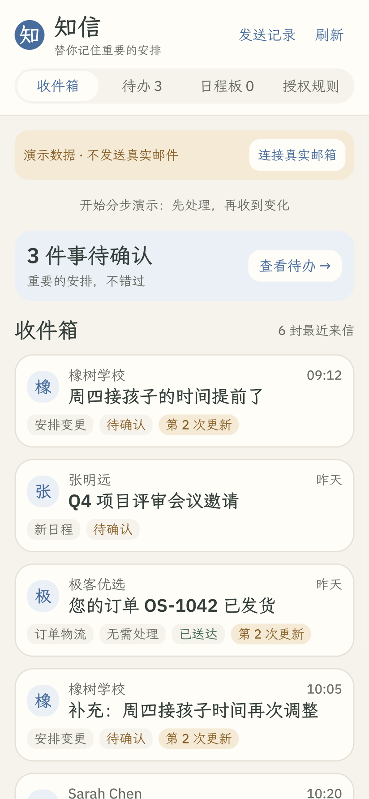
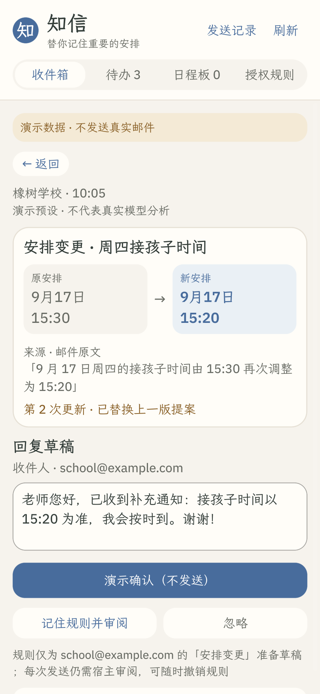
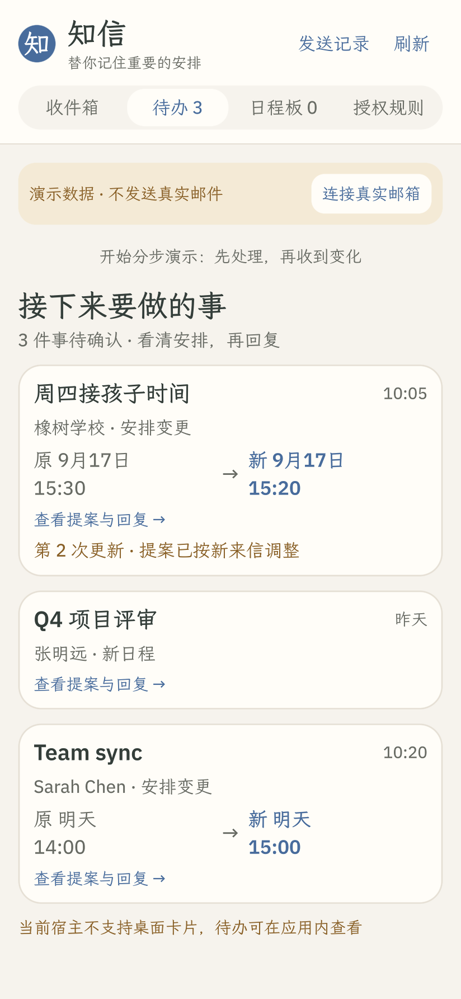

# 知信 0.3.6 · 温暖生活助手界面

用户选择：柔和色彩、亲切感。界面用于邮件中的生活与工作安排，优先让人读清变化、核对来源、编辑回复。

## 本轮设计

| 部分 | 改动与目的 |
| --- | --- |
| 配色 | 奶油色背景 `#f6f3ed`、暖白卡片 `#fffdf8`、柔和蓝 `#486c9c`、鼠尾草绿 `#456b52`；深灰正文保证清楚可读 |
| 顶栏 | 小型知信标识、简短说明、统一分段导航；发送记录和刷新为次要操作 |
| 收件箱 | 演示说明与连接入口合并；正常计数由摘要呈现；来信以紧凑卡片展示，主题与时间分行，状态可换行 |
| 提案 | 原安排/新安排有文字标签，不依赖红绿判断；日期和时间分行，避免窄窗拆开时分；原文依据、草稿和主操作依次排列 |
| 待办 | 「接下来要做的事」呈现事项变化；每卡明确提示可查看提案与回复 |
| 欢迎与空状态 | 说明三个使用步骤；日程、空看板、无来信和发送记录给出简短提示 |
| 状态与错误 | 保留演示未发送、同步错误、模型来源、系统日历及送达边界；桌面能力提示放到内容末尾 |

分隔线由默认 45 点改为 1 点；字级、标签内边距和按钮外边距统一，减少非内容空白。412×892 窗口中，第一封来信主题的纵坐标从 635 提前至 430 点；详情主操作从 797 提前至 723 点，保持完整 46 点高度。

## 验证

- 48 项现有业务回归通过，未改变账号登录、模型核对或发送审阅调用。
- 原生 15 场景通过：收件箱、详情、待办、完成、规则、重放、原文、发送记录、两阶段通知、欢迎、日程、空看板、同步失败、物流。
- 360×800 的 5 场景、840×892 的 4 场景通过；窄窗主要操作完整可见，时间对照允许换行。
- 六组静态文本/背景对比度为 4.67–10.89。这里只验证配色计算，未宣称完整辅助功能标准验收。
- 本地 `hub check --allow-unsigned` 通过，保留无发布签名的开发包警告；扫描产生 7 问材料，未配置模型评审器。

证据：`build/finale-evidence/ui-validation-v0.3.6.json`、三份业务/原生回归日志、配色对比 JSON、原生各场景 `snapshot.json` 与 `card-host.log`。

## 实际渲染

下列图片由本机原生 card-host 渲染，使用内置演示数据；不是设计稿，也不证明真实邮件已连接。

## 当前边界

官方 RC6 当前安装仍为 0.3.3，本轮未操作正在登录的宿主窗口。0.3.6 已放入独立本机测试商店并验签，尚未在真实宿主更新；宿主字体与 card-host 的原生字体可能不同，需要在更新后复查。真实邮箱和模型未认证，收件、人工批准发送、接收端送达与连续录像仍待现场验收。

## 0.3.8 延续与补充

延续温暖生活助手色彩。当前账号旁新增连接检查入口，独立卡片分别说明收信、固定文本模型测试和给自己发测试邮件；显示准确收件账号和明确审阅按钮。收件箱/待办显示本轮模型、规则与缓存计数。物流未知状态隐藏完成进度；此前单号引用单独展示。合并前草稿在展开原文时显示。

0.3.8 当前原生 21 场景通过；对新场景另验证 360×800 / 840×892 各 3 页，窄窗发送主操作完整 46 点可见。官方 RC6 已更新 0.3.8 并显示 10 封真实来信；模型未就绪，发送批准后因宿主 Mail 未登录未获接受。前文 0.3.6 的布局对比及 0.3.3 宿主边界保留为历史记录。
